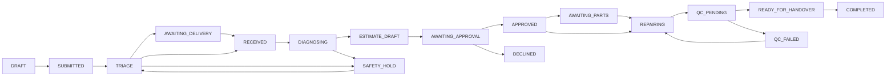

# Ticket finite-state machine and guards

Core statuses are draft until reconciled to existing six SQL drafts. Implementation must use one explicit Enum and typed transition map; no `PATCH status` from UI.

Other terminal/exception routes: `WARRANTY_ROUTE → COMPLETED`, `ANY OPEN → CANCELLED|UNREPAIRABLE` only with custody/consent/reason guards. FSM events from existing source sheet require reconciliation before coding. `AWAITING_APPROVAL` means exactly SENT estimate version. `APPROVED` is not a payment status. `SAFETY_HOLD` cannot transition directly to repairing or QC; requires qualified review and MANAGER second approval. `QC_FAILED` cannot handover. Every transition checks actor permission, expected current version (optimistic concurrency), safety context, device variant capability, stock reservations when applicable and write-once audit. Idempotency cannot bypass a guard.

**Mandatory tests:** invalid transitions return stable 409; stale version returns 409; safety hold emits audit and no service work; QC FAIL forbids handover; cancellation of received device requires custody; warranty route not labeled as our repair; approval on old estimate blocked.
